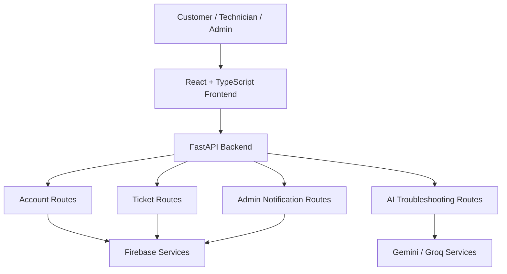

# Multilingual Smart Home AI Helpdesk

An AI-powered, multilingual support platform that helps smart-home users diagnose device issues through guided conversations and raise support tickets when additional assistance is needed.

> **Project status:** Under active development. Features and setup instructions may evolve as the project progresses.

## Table of Contents
- [Overview](#overview)
- [Key Features](#key-features)
- [Supported Languages](#supported-languages)
- [Technology Stack](#technology-stack)
- [Architecture](#architecture)
- [Project Structure](#project-structure)
- [Getting Started](#getting-started)
- [Environment Configuration](#environment-configuration)
- [Running the Application](#running-the-application)
- [API Overview](#api-overview)
- [Security Notes](#security-notes)
- [Contributing](#contributing)
- [License](#license)

## Overview

Smart-home devices make everyday tasks easier, but diagnosing connectivity, configuration, and device-specific problems can be difficult—particularly for users who are more comfortable communicating in their regional language.

**Multilingual Smart Home AI Helpdesk** is designed to simplify this experience. Users can interact with an AI assistant, describe a device problem, receive step-by-step troubleshooting guidance, and create a support ticket when the issue needs human attention.

The platform includes role-oriented experiences for customers, technicians, and administrators to support the service workflow.

## Key Features

- **AI-assisted troubleshooting** — conversational guidance for diagnosing smart-home device issues.
- **Multilingual interaction** — designed for English, Tamil, and Telugu conversations.
- **Device management** — customer-facing device listing and management screens.
- **Support ticket workflow** — create and track tickets when self-service troubleshooting is insufficient.
- **Role-based experiences** — separate application areas for customers, technicians, and administrators.
- **Authentication flows** — registration, login, email verification, and password recovery interfaces.
- **Notifications** — in-app notification experiences for relevant support activity.
- **AI provider integrations** — backend service modules include Google Gemini and Groq integrations.
- **API health endpoint** — check whether the backend service is running.

## Supported Languages

| Language | Code |
|---|---|
| English | `en` |
| Tamil | `ta` |
| Telugu | `te` |

Language availability may vary by feature and AI provider configuration.

## Technology Stack

| Layer | Technologies |
|---|---|
| Frontend | React, TypeScript, Vite |
| Styling | Tailwind CSS |
| Backend | Python, FastAPI |
| AI integrations | Google Gemini, Groq |
| Authentication and data services | Firebase |
| Frontend routing | React Router |
| HTTP client | Axios |
| Icons | Lucide React |

## Architecture

The project follows a frontend–backend architecture:

1. The **React frontend** provides customer, technician, and administrator interfaces.
2. The frontend communicates with the **FastAPI backend** through HTTP API endpoints.
3. The backend routes requests to account, AI, ticket, and notification services.
4. AI service modules connect to configured language-model providers.
5. **Firebase services** support application authentication and data requirements.



## Project Structure

```text
multilingual-smart-home-ai-help-desk-/
├── backend/
│   ├── app/
│   │   ├── api/routes/
│   │   │   ├── account.py
│   │   │   ├── admin_notifications.py
│   │   │   ├── ai.py
│   │   │   └── tickets.py
│   │   ├── core/
│   │   ├── models/
│   │   ├── prompts/
│   │   ├── services/
│   │   └── main.py
│   ├── .env.example
│   ├── requirements.txt
│   └── test_api.py
├── frontend/
│   ├── public/
│   ├── src/
│   │   ├── features/
│   │   │   ├── auth/
│   │   │   ├── customer/
│   │   │   ├── technician/
│   │   │   └── admin/
│   │   ├── services/
│   │   └── main.tsx
│   ├── .env.example
│   ├── package.json
│   └── vite.config.ts
└── README.md
```

## Getting Started

### Prerequisites

- Python 3.10 or later
- Node.js (LTS recommended) and npm
- A Firebase project configured for the services used by the application
- API credentials for the AI provider you intend to use

### 1. Clone the repository

```bash
git clone https://github.com/Balu-Balaji031/multilingual-smart-home-ai-help-desk-.git
cd multilingual-smart-home-ai-help-desk-
```

### 2. Set up the backend

```bash
cd backend
python -m venv .venv
```

Activate the virtual environment:

**Windows (PowerShell):**
```powershell
.\.venv\Scripts\Activate.ps1
```

**macOS / Linux:**
```bash
source .venv/bin/activate
```

Install dependencies:
```bash
pip install -r requirements.txt
```

### 3. Set up the frontend

Open another terminal from the repository root:
```bash
cd frontend
npm install
```

## Environment Configuration

Create local environment files from the supplied examples. Do not commit real credentials.

### Backend

In `backend`, copy `.env.example` to `.env`:
```bash
cp .env.example .env
```

On Windows PowerShell:
```powershell
Copy-Item .env.example .env
```

| Variable | Purpose |
|---|---|
| `FRONTEND_URL` | Frontend origin permitted by backend CORS configuration |
| `FIREBASE_PROJECT_ID` | Firebase project identifier |
| `FIREBASE_WEB_API_KEY` | Firebase Web API key, where required by the backend |

Configure Firebase Admin credentials using the method supported by your environment. Add the AI provider key using the exact variable name expected by the backend service you enable.

### Frontend

In `frontend`, copy `.env.example` to `.env` and configure:

| Variable | Purpose |
|---|---|
| `VITE_API_URL` | Base URL of the backend API |
| `VITE_FIREBASE_API_KEY` | Firebase Web API key |
| `VITE_FIREBASE_AUTH_DOMAIN` | Firebase Authentication domain |
| `VITE_FIREBASE_PROJECT_ID` | Firebase project identifier |
| `VITE_FIREBASE_MESSAGING_SENDER_ID` | Firebase messaging sender ID |
| `VITE_FIREBASE_APP_ID` | Firebase application ID |
| `VITE_FIREBASE_MEASUREMENT_ID` | Firebase Analytics measurement ID, if used |

Only variables prefixed with `VITE_` are exposed to frontend code. Never place service-account credentials or server-side AI API keys in frontend environment variables.

## Running the Application

### Start the backend

From the `backend` directory, with the virtual environment activated:
```bash
uvicorn app.main:app --reload --host 127.0.0.1 --port 8000
```

Backend endpoints:
- API base: `http://127.0.0.1:8000`
- Health check: `http://127.0.0.1:8000/health`
- Interactive API documentation: `http://127.0.0.1:8000/docs`

### Start the frontend

From the `frontend` directory:
```bash
npm run dev
```

Vite prints the development URL in the terminal (typically `http://localhost:5173`).

### Build and preview the frontend

```bash
npm run build
npm run preview
```

## API Overview

The backend currently registers these route groups:

| Prefix | Purpose |
|---|---|
| `/health` | Backend health check |
| `/api/ai` | AI troubleshooting and conversation sessions |
| `/api/tickets` | Support ticket operations |
| `/api/account` | Account-related operations |
| `/api/admin-notifications` | Administrator notification operations |

Run the backend and open `/docs` to inspect available endpoints, request schemas, and response formats.

## Security Notes

- Do not commit `.env` files, API keys, Firebase service-account files, or other secrets.
- Use `.env.example` files as templates with placeholder values only.
- Restrict Firebase security rules and backend permissions according to user roles.
- Configure production CORS origins explicitly.
- Store private AI provider credentials only on the backend.
- Review authentication, authorization, file upload, and ticket access rules before production deployment.

## Contributing

Contributions, bug reports, and improvement suggestions are welcome.

1. Fork the repository.
2. Create a feature branch: `git checkout -b feat/your-feature`.
3. Make and test your changes.
4. Commit your work: `git commit -m "feat: describe your change"`.
5. Push the branch and open a Pull Request.

Please keep contributions focused and include relevant testing details in your pull request.

## License

No license file is currently included in this repository. Until a license is added, the project should be treated as all rights reserved; reuse and redistribution are not automatically permitted.

---

<p align="center">
  Developed to make smart-home support more accessible through multilingual, AI-assisted troubleshooting.
</p>
